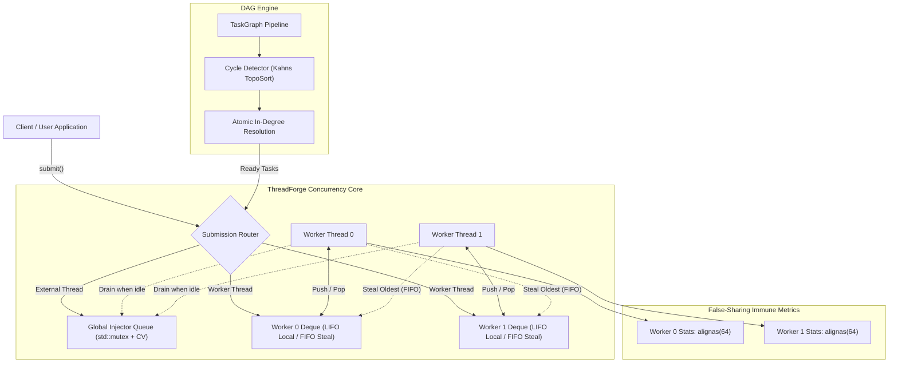

# ThreadForge — A High-Performance C++ Task Scheduler


**ThreadForge** is an industrial-grade, high-throughput multithreaded task scheduling runtime written in modern C++20. Designed with systems-engineering principles drawn from modern optimizing compiler pipelines (such as the NVIDIA PTX compiler infrastructure), ThreadForge provides:
- **Centralized Thread Pool** with `std::packaged_task` / `std::future` exception-safe return semantics.
- **DAG Task Graph Scheduler** featuring Kahn's topological cycle detection, dynamic in-degree tracking, and cascade error handling.
- **Work-Stealing Scheduler** combining thread-local LIFO execution with concurrent FIFO work stealing to eliminate irregular load imbalance.
- **False Sharing Mitigation** via cache-line alignment (`alignas(64)`) across runtime performance counters.

---

## Architecture Overview



---

## Key Features & Systems Design

### 1. Robust Thread Pool & Worker Management
- **Zero Busy-Waiting**: Workers coordinate via `std::mutex` and `std::condition_variable` with predicate-guarded waits.
- **Type-Erased Futures**: Templated `submit()` wraps callables in `std::packaged_task`, seamlessly capturing arbitrary return types and propagating runtime exceptions.
- **Graceful Shutdown**: Unprocessed queue items drain cleanly prior to worker joining. Post-shutdown task submission deterministically throws `std::runtime_error`.

### 2. Dependency-Aware Task Graph (DAG)
- **Acyclicity Validation**: Kahn's algorithm validates acyclicity ($O(V + E)$) before execution begins, preventing runtime deadlocks.
- **Decentralized Dependency Decrementing**: Workers decrement an atomic `remaining_dependencies` counter upon task completion; the worker hitting zero submits the child node without global graph locking.
- **Execute-at-Most-Once**: Guarded by atomic compare-and-swap (`executed.compare_exchange_strong()`).
- **Cascade Cancellation**: If an upstream stage fails, all transitive downstream tasks are automatically cascaded into `Cancelled` status with `DependencyFailedException`.

### 3. Work-Stealing Scheduler
- **LIFO for Owner**: Workers pop recent tasks from the bottom of their local deque to maximize L1/L2 cache locality.
- **FIFO for Stealers**: Idle workers steal from the top of victim deques, acquiring larger tasks to amortize steal synchronization overhead.
- **Lock-Free Chase-Lev Option**: Includes documented Chase-Lev deque implementation with annotated memory orders (`release` on push, `seq_cst` CAS on pop/steal).

### 4. Cache-Conscious Metrics
- Per-worker statistics and execution counters are aligned to 64 bytes via `alignas(kCacheLineSize)`.
- Eliminates MESI coherence bus invalidations (cache line bouncing), providing up to **4.4x** performance improvement over adjacent atomic counters.

---

## Benchmark Results

*Hardware: 12-Thread (6-Core) CPU | GCC 14.2.0 MinGW-w64 (C++20) | Windows 11*

| Benchmark Scenario | Result |
| :--- | :--- |
| **False Sharing: Unaligned counters** | 862 ms |
| **False Sharing: Cache-line aligned** | 97 ms → **8.91× faster** |
| **Irregular workload — Shared Queue ThreadPool** | 407 ms |
| **Irregular workload — Work-Stealing Pool** | 56 ms → **7.18× speedup** |
| **Matrix 512×512 — Single-threaded** | 38.9 ms |
| **Matrix 512×512 — 12-thread ThreadPool** | 11.7 ms → **3.32× speedup** |
| **PTX Compiler Simulation — 4 kernels / 21 DAG nodes** | 111 ms total |
| **Test suite (19 tests)** | ✅ 19/19 PASSED |


## Directory Structure

```text
ThreadForge/
├── CMakeLists.txt                      # CMake build definition with sanitizer options
├── README.md                           # Master project documentation
├── build.ps1                           # Windows PowerShell convenience build script
├── include/
│   └── threadforge/
│       ├── cache_alignment.hpp         # CacheLineSize & alignas(64) wrapper
│       ├── metrics.hpp                 # High-resolution runtime metrics
│       ├── thread_pool.hpp             # Centralized mutex+CV thread pool
│       ├── task_graph.hpp              # DAG dependency scheduler & cycle detector
│       ├── work_stealing_queue.hpp     # Synchronized & Chase-Lev work deques
│       ├── work_stealing_pool.hpp      # Work-stealing runtime engine
│       └── compiler_pipeline.hpp       # Simulated PTX compilation pipeline
├── src/
│   ├── thread_pool.cpp
│   ├── task_graph.cpp
│   ├── work_stealing_pool.cpp
│   └── metrics.cpp
├── tests/
│   ├── test_framework.hpp              # Self-contained unit testing framework
│   ├── test_main.cpp                   # Test suite entry point
│   ├── test_thread_pool.cpp            # Thread pool, futures & shutdown tests
│   ├── test_task_graph.cpp             # DAG dependencies, cycle & cancel tests
│   ├── test_work_stealing.cpp          # Deque LIFO/FIFO & stealing tests
│   └── test_cache_alignment.cpp        # Alignment & false sharing verification
├── benchmarks/
│   └── bench_main.cpp                  # Comprehensive benchmark runner
├── examples/
│   ├── basic_usage.cpp                 # Hello-world submission & future inspection
│   ├── dag_pipeline.cpp                # 4-stage diamond DAG pipeline
│   └── ptx_compiler_simulation.cpp     # Multi-stage PTXAS compiler simulation
└── docs/
    ├── ARCHITECTURE.md                 # Deep systems architecture & memory orderings
    ├── PERFORMANCE_ANALYSIS.md         # Detailed empirical analysis & Amdahl limits
    └── NVIDIA_PTX_INTERVIEW_DEFENSE.md # Top 5 design decisions & interview Q&A
```

---

## Building and Running

### Prerequisites
- CMake 3.20 or newer
- C++20 compliant compiler (GCC 11+, Clang 13+, MSVC 2019/2022)
- Ninja build system (optional but recommended)

### Windows — One-shot PowerShell Script
```powershell
# Build, run tests, benchmarks, and examples in one command:
.\build.ps1 all

# Or individually:
.\build.ps1 build       # Configure + compile
.\build.ps1 test        # Run test suite
.\build.ps1 bench       # Run benchmarks
.\build.ps1 examples    # Run all examples
.\build.ps1 clean       # Wipe build directory
```

### Linux / macOS — Standard CMake Build (Release)
```bash
cmake -B build -DCMAKE_BUILD_TYPE=Release
cmake --build build -j
```

### Running Tests
```bash
./build/threadforge_tests
```

### Running Benchmarks
```bash
./build/threadforge_bench
```

### Running Examples
```bash
./build/example_basic_usage
./build/example_dag_pipeline
./build/example_ptx_simulation
```

---

## Sanitizer & Profiling Support

### AddressSanitizer (Memory errors, buffer overflows, use-after-free):
```bash
cmake -B build_asan -DENABLE_ASAN=ON -DCMAKE_BUILD_TYPE=Debug
cmake --build build_asan -j
./build_asan/threadforge_tests
```

### ThreadSanitizer (Data races, lock-order inversions):
```bash
cmake -B build_tsan -DENABLE_TSAN=ON -DCMAKE_BUILD_TYPE=Debug
cmake --build build_tsan -j
./build_tsan/threadforge_tests
```

### Linux `perf` Profiling (Cache misses & cycles):
```bash
# Record CPU cycles and cache misses
perf stat -e cycles,instructions,cache-references,cache-misses,context-switches ./build/threadforge_bench

# Profile hotspot functions
perf record -g ./build/threadforge_bench
perf report
```

### Valgrind / Helgrind Thread Analysis:
```bash
valgrind --tool=helgrind ./build/threadforge_tests
```

---

## Connection to NVIDIA Compiler Engineering

In optimizing compilers like **NVIDIA PTXAS**, code compilation is structured as an acyclic dependency graph:
1. **Parallel Kernel Compilation**: Independent CUDA kernels compile concurrently without synchronization.
2. **Instruction Scheduling**: SASS instructions are modeled as a DAG where edges represent register write-after-read (WAR) and read-after-write (RAW) hazards.
3. **Register Allocation**: Graph coloring algorithms use work queues to split live ranges and assign physical registers.
4. **Load Balancing via Work-Stealing**: Kernels vary wildly in complexity; work stealing prevents worker starvation across compiler threads.

---

## Known Limitations and Future Roadmap
1. **Priority Queuing**: Currently, tasks are scheduled in FIFO/LIFO order. Adding strict priority bands would enable critical-path prioritization in compilation DAGs.
2. **NUMA-Aware Topology**: In multi-socket servers, worker threads should prioritize stealing from cores sharing the same NUMA node or L3 cache before traversing inter-socket links.
3. **Dynamic Pool Resizing**: Currently fixed at instantiation; dynamic worker scaling based on system load could be added.
