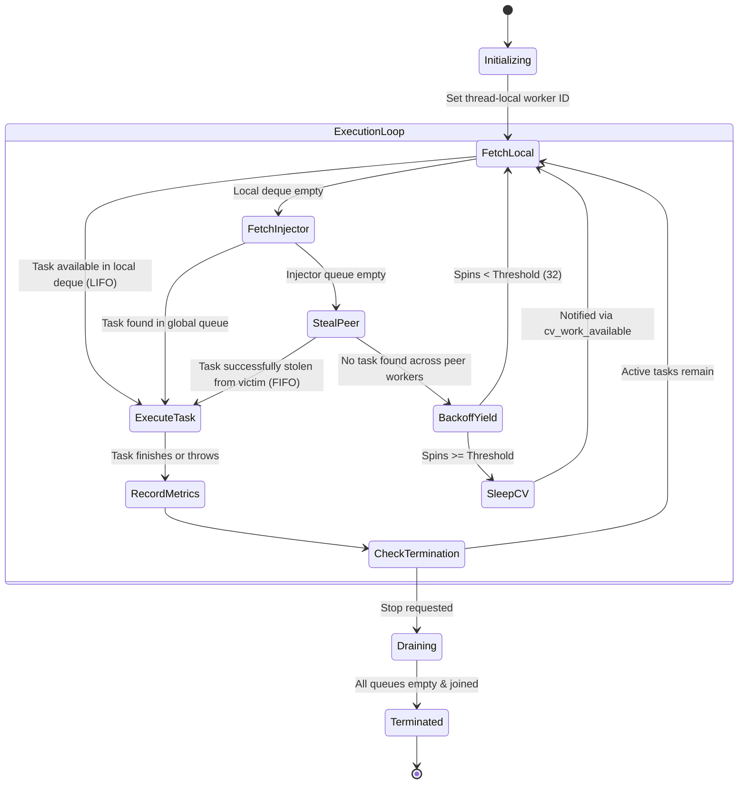

# ThreadForge Architecture and Systems Design Document

## 1. System Overview

**ThreadForge** is a high-performance multithreaded task scheduling runtime built in modern C++20. Designed with principles drawn from high-throughput compiler backends, ThreadForge explores execution topologies across three core paradigms:
1. **Centralized Thread Pool**: Coordinated via bounded/unbounded synchronized queues with condition-variable wakeups.
2. **Directed Acyclic Graph (DAG) Task Engine**: Dynamic in-degree dependency tracking with Kahn's topological cycle detection and exception cascade handling.
3. **Work-Stealing Scheduler**: Decentralized per-worker LIFO deques with concurrent FIFO work-stealing, minimizing contention and eliminating load imbalance in irregular workloads.

---

## 2. Architecture Diagram

```mermaid
graph TD
    Client["Client / Application Code"] -->|submit()| PoolRouter{"Submission Router"}

    subgraph "ThreadForge Concurrency Runtime"
        PoolRouter -->|External Thread| InjectorQ[("Global Injector Queue<br/>std::queue + std::mutex")]
        PoolRouter -->|Worker Thread| LocalQ1[("Worker 0 Deque<br/>LIFO Local / FIFO Steal")]
        PoolRouter -->|Worker Thread| LocalQ2[("Worker 1 Deque<br/>LIFO Local / FIFO Steal")]

        subgraph "Worker Threads"
            W0["Worker Thread 0"]
            W1["Worker Thread 1"]
            WN["Worker Thread N-1"]
        end

        W0 <-->|Push / Pop LIFO| LocalQ1
        W1 <-->|Push / Pop LIFO| LocalQ2

        W0 -.->|Steal FIFO (Victim)| LocalQ2
        W1 -.->|Steal FIFO (Victim)| LocalQ1

        W0 -.->|Drain if idle| InjectorQ
        W1 -.->|Drain if idle| InjectorQ
    end

    subgraph "DAG Engine"
        DAG["TaskGraph<br/>Dependency Resolver"]
        TopSort["Topological Sort<br/>Cycle Detector (Kahn's)"]
        AtomicInDeg["Atomic In-Degree<br/>fetch_sub() Resolution"]
        DAG --> TopSort
        TopSort --> AtomicInDeg
        AtomicInDeg -->|Ready Tasks| PoolRouter
    end

    subgraph "Cache-Conscious Metrics"
        M0[("Aligned Worker 0 Stats<br/>alignas(64)")]
        M1[("Aligned Worker 1 Stats<br/>alignas(64)")]
        MN[("Aligned Worker N Stats<br/>alignas(64)")]
        W0 --> M0
        W1 --> M1
        WN --> MN
    end
```

---

## 3. Worker Lifecycle and State Transitions

Each worker thread follows an efficient, non-busy-waiting execution loop designed to maximize throughput and minimize CPU burning when idle.



---

## 4. Queue Synchronization & Memory Ordering Strategy

### A. Centralized Thread Pool Synchronization
- **Primitives**: `std::mutex`, `std::condition_variable`, `std::queue<TimedTask>`, `std::atomic<bool>`.
- **Worker Wakeup**: `notify_one()` on task submission; `notify_all()` on shutdown.
- **Wait Condition**: `cv_task_available_.wait(lock, [this] { return stop_requested_ || !tasks_.empty(); });`
- **Rejection Policy**: Submissions post-shutdown throw `std::runtime_error`, preventing dangling work or leaked memory.

### B. Synchronized Work-Stealing Deque
- **Ownership Model**:
  - The **owning worker** accesses the `BOTTOM` of the deque in LIFO order (`push_bottom`, `pop_bottom`).
  - **Stealing workers** access the `TOP` of the deque in FIFO order (`steal_top`).
- **Cache Locality Rationale**:
  - Pushing and popping recently submitted child tasks at the bottom preserves hot cache lines in L1/L2 data caches.
  - Stealers take the oldest tasks from the top, which typically represent larger, coarser-grained task subtrees, amortizing synchronization overhead across many subsequent local operations.

### C. Chase-Lev Lock-Free Deque Design & Linearization Points
The Chase-Lev algorithm allows lock-free single-producer multi-consumer operations over a circular buffer:
1. **Push Linearization Point**:
   ```cpp
   buffer_[b & mask_] = std::move(task);
   bottom_.store(b + 1, std::memory_order_release);
   ```
   The release store guarantees the task pointer/functor is committed to memory before the incremented `bottom_` index becomes visible to concurrent stealers.

2. **Pop Linearization Point**:
   ```cpp
   int64_t b = bottom_.load(std::memory_order_relaxed) - 1;
   bottom_.store(b, std::memory_order_seq_cst);
   int64_t t = top_.load(std::memory_order_seq_cst);
   ```
   When `t == b` (the last remaining task), a race exists between owner and stealer. The owner executes a sequential consistency CAS on `top_`:
   ```cpp
   if (!top_.compare_exchange_strong(expected, t + 1, std::memory_order_seq_cst, std::memory_order_relaxed)) {
       // Stealer won race: restore bottom_ and yield
   }
   ```

3. **Steal Linearization Point**:
   ```cpp
   int64_t t = top_.load(std::memory_order_acquire);
   std::atomic_thread_fence(std::memory_order_seq_cst);
   int64_t b = bottom_.load(std::memory_order_acquire);
   if (t < b && top_.compare_exchange_strong(t, t + 1, std::memory_order_seq_cst, std::memory_order_relaxed)) {
       // Task successfully acquired
   }
   ```

---

## 5. Directed Acyclic Graph (DAG) Execution Model

### A. Cycle Detection (Kahn's Algorithm)
Before scheduling, `TaskGraph::topological_sort()` verifies that the graph contains no cycles in $O(V + E)$ time:
1. Calculates in-degree for all vertices $v \in V$.
2. Enqueues all vertices with in-degree 0 into a processing FIFO.
3. Iteratively dequeues $u$, appends $u$ to sorted list, and decrements in-degree of all successors $v \in \text{Adj}[u]$.
4. If $|Sorted| \neq |V|$, a directed cycle exists; the scheduler immediately aborts and throws `CycleDetectedException`.

### B. Dynamic Dependency Decrementing
- Each `TaskNode` tracks an atomic `remaining_dependencies`.
- Root nodes (initial in-degree 0) are submitted to the thread pool immediately upon `execute()`.
- Upon task completion, the worker iterates over successors and calls:
  ```cpp
  size_t prev = child->remaining_dependencies.fetch_sub(1, std::memory_order_acq_rel);
  if (prev == 1) { // Exactly reached zero: ready to execute!
      pool.submit(...);
  }
  ```
- **Execute-at-most-once guarantee**: Enforced by an atomic CAS flag `executed.compare_exchange_strong(false, true)`.

### C. Exception Propagation & Cascade Cancellation
- If a task throws an unhandled exception, it is caught in the worker wrapper and stored via `std::current_exception()`.
- The task status is marked `Failed`.
- The scheduler executes `cascade_cancel(id)`: all downstream transitive dependents are marked `Cancelled` and populated with a `DependencyFailedException`.
- Independent branches of the DAG that do not depend on the failed node continue running to completion.
- `TaskGraph::throw_if_failed()` allows the caller to catch and rethrow the failure on the main thread.

---

## 6. False Sharing & Memory Layout Analysis

### The Cache Line Invalidation Bottleneck
In modern x86-64 and ARM64 architectures, CPU caches maintain coherence via cache lines (typically 64 bytes) using protocols such as MESI or MOESI.
- If Thread 0 writes to `counters[0]` and Thread 1 writes to `counters[1]`, and both integers reside in the same 64-byte line:
  - Every write invalidates the entire cache line in the other core's L1/L2 cache.
  - The cache line constantly bounces between cores over the interconnect (cache ping-ponging).
  - Performance degrades by an order of magnitude despite zero logical lock contention!

### ThreadForge Mitigation
ThreadForge introduces `CacheAligned<T>`:
```cpp
template <typename T>
struct alignas(kCacheLineSize) CacheAligned {
    T value;
};
```
- In `ExecutionMetrics`, per-worker task completion counters are stored as:
  ```cpp
  std::vector<CacheAligned<std::atomic<uint64_t>>> per_worker_completed_;
  ```
- Each worker modifies exclusively its own dedicated cache line, eliminating coherence traffic during metrics recording.
